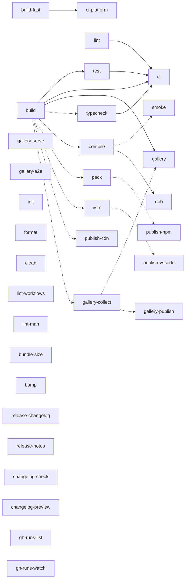

# Makefile Reference

The [`Makefile`](./Makefile) is the single source of truth for this repo's
build / test / lint / package / publish command strings. Humans, local agents,
cloud agents, and CI all run the same verbs — the GitHub Actions workflows call
`make <target>`, so a green `make ci` locally runs the same gate CI runs.

`make help` is the fast terminal lookup; this file is the narrative reference.

## Target Dependencies



Solid arrows are hard prerequisites — running a target automatically runs
everything to its left (`make ci` runs `lint`, `build`, `typecheck`, `test`,
in that order; `make test` runs `build` first; `make ci-platform` runs
`build-fast` first and never reaches `build`). Dotted arrows mark a softer
relationship: the target consumes another's output but does not hard-depend on
it. `typecheck` reads sibling packages' built `dist/` types, so `ci` orders it
after `build` rather than making every standalone `make typecheck` rebuild.
`publish-npm` publishes the tarballs `pack` produces, but in the release
pipeline that artifact is built in a separate CI job and handed over — see
[Why `publish-*` don't hard-depend on `build`](#why-publish-dont-hard-depend-on-build).

## Targets

### Develop

| Target | Description |
|--------|-------------|
| `help` | List targets, grouped (the default goal) |
| `init` | Install workspace dependencies from the frozen lockfile (`pnpm install --frozen-lockfile`) |
| `build` | Build every package and render `examples/` + `tests/` to SVG (`pnpm build`) |
| `build-fast` | Build every package but skip rendering `examples/` + `tests/` — the inner dev loop (`NOWLINE_SKIP_RENDER=1 pnpm build`) |
| `lint` | Static check: biome lint + format-drift + import organization, no writes (`pnpm check`) |
| `format` | Auto-fix formatting, lint, and import order (`pnpm check:fix`) |
| `typecheck` | Type-check the packages that opt in (`pnpm typecheck`). Needs a prior `build`: several packages resolve sibling `@nowline/*` types from `dist/` |
| `test` | Run every package's Vitest suite (`pnpm -r test`) and the `node:test` specs under `scripts/gallery/test/` and `scripts/test/` (the latter guards the `engines` floors); depends on `build` |
| `doctor` | Check the tools in `triage.yaml` (read-only): errors below a floor, warns below a pin. `MODE=default\|release\|ci` picks the profile; `STRICT=1` adds `triage --strict` so warnings fail, which is how CI's `triage` job runs it on the `.nvmrc` pin |
| `ci` | The full pre-push gate: `lint` + `build` + `typecheck` + `test`, in that order. The canonical CI cell (`ubuntu-latest`, Node 26) runs this target directly on a clean checkout |
| `ci-platform` | Slim gate for the other build-test cells (`ubuntu-latest` Node 22, macOS, Windows): `build-fast`, then `pnpm -r test` and the script tests. No lint, typecheck, or render: those have never differed by OS or Node version, while every platform bug so far was a Windows path bug that Vitest caught. Calls `pnpm -r test` itself rather than depending on `test`, so it never re-runs the full `build` |
| `pre-commit` | Local alias of `ci` — run before committing or pushing |
| `gallery` | Render everything (`build`), then `gallery-collect`, then `scripts/gallery/publish.mjs` adds the snapshot to the history in `$(GALLERY_DIR)/data` and regenerates `$(GALLERY_DIR)/site`. Every build belongs to a line: `main`, `pr-<n>` in CI, or locally the current git branch. A `main` build compares against the previous `main` build; a local branch's first build compares against the newest `main` build and later ones against the branch's previous build; a PR build compares against the `main` build at the PR's base sha (else the newest retained `main` ancestor of it). So `make gallery` on `main` and then on a branch shows the branch's render drift. Retention: the newest `GALLERY_KEEP` (default 100) per `main` and local branch line, `GALLERY_KEEP_PR` (default 10) per PR line. `publish.mjs` treats the raw build as untrusted and needs exactly one trust flag: `gallery` passes `--trusted-local` (your own tree, any line; refused under GitHub Actions), while a publishing workflow passes `--pr <n>` (the build must be PR n's) or `--trusted-main` (it must be a `main` build). Open `.gallery/site/index.html`, or use `gallery-serve` |
| `gallery-collect` | Collect only, with no `build` prerequisite: `scripts/gallery/collect.mjs` snapshots the already-rendered SVGs, their sources and the commit into `$(GALLERY_DIR)/raw`. In CI the workflow sets `GALLERY_LINE`, `GALLERY_PR_NUMBER`, `GALLERY_PR_TITLE`, `GALLERY_PR_URL`, `GALLERY_HEAD_REF`, `GALLERY_HEAD_SHA`, `GALLERY_BASE_SHA`, `GALLERY_AUTHOR` and `GALLERY_DATE`, because a PR is checked out as its merge commit; the build's sha is then the PR head |
| `gallery-publish` | CI half of `gallery`, run by `.github/workflows/gallery.yml`: `scripts/gallery/publish.mjs` adds the build in `$(GALLERY_DIR)/raw` (downloaded from the CI run) to the history in `$(GALLERY_DIR)/data` (checked out from the `gallery-data` branch) and regenerates `$(GALLERY_DIR)/site`. `GALLERY_TRUST` is required and comes from the triggering run, never the build: `--pr <n>` or `--trusted-main`. `GALLERY_REPO` (owner/name) and `GALLERY_SHA` (the run's head sha) pin the build to the repository and commit. Every PR line not in `GALLERY_OPEN_PRS` is dropped, so an empty value drops them all except the line just published |
| `gallery-serve` | Serve `$(GALLERY_DIR)/site` over http on every interface at `GALLERY_PORT` (default 8080), so a phone on the same network can browse it; http also enables the pixel diff and per-item history strip, which `file://` blocks |
| `gallery-e2e` | Browser leg for the review gallery, next to `mcp-app-e2e`: publishes a synthetic three-build history with `scripts/gallery`, serves it with `scripts/gallery/serve.mjs`, and drives `gallery.js` in headless Chromium (view settings carried across pages, source toggle, Changed only, history links, Diff pixel count, layout and no horizontal scroll at phone and tablet sizes, range compare). Installs Chromium through Playwright unless `NOWLINE_E2E_CHROMIUM` points at an existing binary. Needs a browser, so it is not part of `make ci` or `make test` |
| `clean` | Remove build / binary / package artifacts (keeps `node_modules`) |
| `lint-workflows` | actionlint the GitHub Actions workflows (`pnpm lint:workflows`); fails fast without shellcheck on PATH, since actionlint would otherwise skip the `run:` script checks CI does |
| `lint-man` | `mandoc -T lint` every man page at warning level, minus the two warnings translated pages raise for their localized `NAME` section. Needs `mandoc` on PATH (apt `mandoc`; ships with macOS). Not part of `ci`: Windows has no mandoc, so CI runs it in one Linux job |
| `bundle-size` | Build the embed dependency graph and run the CDN bundle-size + `node:*` leak gate |

### GitHub

Local-only dev tools for monitoring this repo's GitHub Actions runs. Not invoked
by any CI workflow. Requires `gh` on PATH and authentication (`gh auth login`).

| Target | Description |
|--------|-------------|
| `gh-runs-list` | List in-flight Actions runs in this repo (`status != completed`: queued, in_progress, waiting, requested, pending). Columns: status, workflow, branch, event, URL. Tunable via `GH_LIMIT` (default 50). |
| `gh-runs-watch` | Watch each in-flight run until it completes (`gh run watch --compact`). Prints `no active runs` when idle. |

### Release

| Target | Description |
|--------|-------------|
| `compile` | Compile standalone CLI binaries (`TARGET=bun-<os>-<arch>` or `local`; omit for all). Needs Bun and a prior `build`. |
| `smoke` | Smoke-test a compiled binary across every export format (host-derived, or `MATRIX_*` from CI). Runs it only if the host can execute it (same OS and arch, or darwin-x64 under Rosetta) and skips otherwise; under GitHub Actions a skip fails unless `SMOKE_ALLOW_CROSS_TARGET=1`. |
| `deb` | Build a `.deb` wrapping the compiled binary (`ARCH=amd64\|arm64`) |
| `pack` | Pack the publishable `@nowline/*` npm tarballs into `dist-pack/` (dependency order) |
| `vsix` | Package the VS Code / Cursor extension into a `.vsix` |
| `bump` | Bump every package version (`LEVEL=patch\|minor\|major`); prints the new version |
| `release-changelog` | Fold every `.changelog/` fragment into a dated `## [X.Y.Z]` section of the `CHANGELOG.md` beside it, then delete the fragments (`VERSION=X.Y.Z`) |
| `release-notes` | Print the body of the root `CHANGELOG.md`'s `[X.Y.Z]` section, the GitHub Release page's text (`VERSION=X.Y.Z`; `LINK_BASE=<url>` makes relative links absolute) |
| `changelog-check` | Validate `.changelog/` fragments; `BASE=<ref>` also fails on new entries in a `CHANGELOG.md`, and `REQUIRE=1` on a branch with no fragment |
| `changelog-preview` | Print the section each `CHANGELOG.md` would gain at the next release |

### Danger

Remote-mutating targets. Each refuses to run unless its action-specific
`CONFIRM_*` variable is set, and prints what it would touch + how to proceed.
CI sets the variable inline in the release / deploy workflow; a human or agent
running it by hand hits the friction. Excluded from `make ci`.

| Target | Guard | Description |
|--------|-------|-------------|
| `publish-npm` | `CONFIRM_PUBLISH` | Publish the `@nowline/*` tarballs in `dist-pack/` to npmjs.com |
| `publish-vscode` | `CONFIRM_PUBLISH` | Publish the extension to the VS Code Marketplace + Open VSX (`VSIX=` path) |
| `publish-cdn` | `CONFIRM_DEPLOY` | Deploy the `@nowline/embed` bundle to the Firebase Hosting CDN (`PROJECT_ID=`, `FIREBASE_PROJECT_PATH=`) |

Example: `make publish-npm` prints

```
Refusing to run "make publish-npm": Publishes @nowline/* to npmjs.com
This pushes to a remote. Re-run with CONFIRM_PUBLISH=1 (CI sets this in the release/deploy workflow).
```

The guard protects the sanctioned path (`make publish-*`); a raw `npm publish`
still works, so it complements rather than replaces npm-native guards. It is the
friction for the command people and agents actually reach for.

### Why `publish-*` don't hard-depend on `build`

The standard convention chains heavier targets onto lighter gates so they can't
be skipped (`ci: lint build typecheck test`, `test: build`). The guarded
`publish-*` targets are the one deliberate exception in this repo: nowline's
release pipeline builds artifacts **once** in [`build.yml`](./.github/workflows/build.yml)
and hands them to a separate, pure-push publish/deploy job
([`release.yml`](./.github/workflows/release.yml),
[`embed-cdn.yml`](./.github/workflows/embed-cdn.yml)) that has no build
toolchain installed. A hard `build` prerequisite would make those CI steps fail
(and re-running the whole build on a publish runner defeats the artifact
handoff). Instead each guarded target asserts its prebuilt input exists
(`dist-pack/*.tgz`, the `.vsix`, the CDN `public/` tree) and fails loudly if
not — preserving the "never ship an unbuilt artifact" guarantee for a manual
run while keeping CI's job separation intact. For a clean local publish, run the
producing target first (`make build pack` then `CONFIRM_PUBLISH=1 make publish-npm`).

## GitHub Actions

YAML owns orchestration (triggers, concurrency, permissions, toolchain setup +
caching, the OS/Node matrix, WIF auth, artifact upload, PR comments); the
Makefile owns the command strings. Each gate step is `run: make <target>`, which
keeps per-step logs and the matrix while sourcing the command from one place.

| Workflow | Trigger | What it does | make targets |
|----------|---------|--------------|--------------|
| [`ci.yml`](./.github/workflows/ci.yml) | push to `main`, pull requests, merge queue | Strict env doctor on the `.nvmrc` pin; lint workflows; lint man pages; the full `make ci` gate (lint + build + typecheck + test) on a clean checkout on `ubuntu-latest` Node 26, and `make ci-platform` (build-fast + Vitest) on the Node 22, macOS, and Windows cells (macOS and Windows only in the merge queue and on `main`; a PR runs the Linux cells); embed bundle-size gate; export-determinism and MCP harness gates; release-build smoke (calls `build.yml`, in parallel with the test matrix; Linux cells only on a PR); a docs-only PR or queue entry (Markdown outside `packages/` and `.github/`, except `specs/dsl.md`) skips every build and test job, while push to `main` always runs everything; the aggregate `CI gate` job, the only check the `main` ruleset requires | `doctor` (as `MODE=ci STRICT=1`, through `lolay/triage-action`), `lint-workflows`, `lint-man`, `ci`, `ci-platform`, `bundle-size`, `build-fast`, `compile`, `determinism`, `determinism-browser`, `mcp-inspector-smoke`, `mcp-app-e2e` |
| [`build.yml`](./.github/workflows/build.yml) | reusable (called by `ci.yml` smoke + `release.yml`) | 10-cell build/package matrix: compile per-OS/arch binaries and smoke each on a runner that can execute it (native `ubuntu-24.04-arm` / `windows-11-arm` for arm64, Rosetta for macOS x64), build `.deb`s, pack npm tarballs, package the `.vsix`, stage the action mirror + embed CDN bundle | `compile`, `smoke`, `deb`, `pack`, `vsix` |
| [`release.yml`](./.github/workflows/release.yml) | `v*` tag push, manual dispatch | Cut release (bump + tag), call `build.yml` with upload, publish to npm + Marketplace + Open VSX, GitHub release + Homebrew tap + action mirror, deploy prod embed CDN | `bump`, `release-changelog`, `release-notes`, `publish-npm`, `publish-vscode` (guarded with `CONFIRM_PUBLISH=1`) |
| [`changelog.yml`](./.github/workflows/changelog.yml) | pull requests (including label changes), merge queue | Validate `.changelog/` fragments; on a PR, require one unless it's labelled `no-changelog`, and reject new entries written straight into a `CHANGELOG.md`. The `Changelog` check is required by the `main` ruleset | `changelog-check` |
| [`embed-cdn.yml`](./.github/workflows/embed-cdn.yml) | push to `main`, pull requests, manual dispatch | Build the dev IIFE; continuous-deploy `embed.nowline.dev`; per-PR ephemeral preview channel | `publish-cdn` (guarded with `CONFIRM_DEPLOY=1`, embed-dev job) |

Other workflows (`copilot-pr-*`, `agent-*`, `editor-release-monitor.yml`,
`vscode-extension-engine-bump.yml`, the generated `agent-*.lock.yml`) run
label/issue/PR plumbing or agent-runtime setup, not product build/test/deploy
commands, so they call no make target. The Makefile is the source of truth:
change a command there, not in the workflow.
