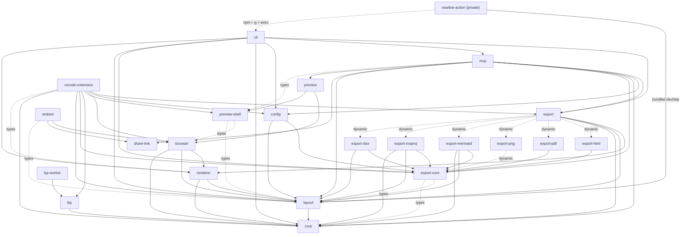

# Session handoff: r1 full review (in progress)

Branch: claude/affectionate-meitner-5wxwdt (harness-assigned task branch, off origin/main a5287055ac8da4a7312d2e780f3aff5ff648547d). Review r1, kind full, at that SHA. #241 has merged, so the review PR also replaces the Review: line in specs/handoffs/handoff-m4.15-true-width-layout.md.

Done: seven fresh reviewers (architecture, contracts, security, tests, deps+duplication, hotspots A, hotspots B), Opus xhigh. Their raw findings and the deduplicated candidate list are below.

Pending: verifier pass, then register, summary, specs/reviews/README.md, handoff Review line; make pre-commit; push; ask the Owner before opening the PR and tracking issue. Remove this file as the last commit before the PR.

# r1 candidate findings (deduplicated)

Source findings are in /workspace/nowline/.scratch/r1-work/findings/*.md (IDs C*, HA*, HB*, A*, S*, T*, D*, DU*). Where several reviewers reported the same defect, they are merged here; verify the union of their evidence.

| # | Title | Sources | Proposed severity / kind |
| --- | --- | --- | --- |
| 1 | MCP file tools: no `.nowline` extension check, lexical-only root check (symlinks escape), includes unrooted (out-of-root `.nowline` read into output) | S1, HA3, A2 | high / fix |
| 2 | MCP Streamable HTTP `--port` has no Host/Origin check (DNS rebinding drives read/create/delete) | HA2, S5 | high / fix |
| 3 | HTML export: roadmap title injected into `aria-label` with text-only escaping (attribute injection, XSS) | S2 | high / fix |
| 4 | `link:` accepts any scheme; `javascript:` reaches `<a href>` in live SVG (embed, preview, HTML export) | S3 | high / fix |
| 5 | `agent-verdict-apply` lets any commenter set state labels with the maintainer PAT; agent-deep trusts any `## Plan` comment | S4 | high / fix |
| 6 | Transient Langium documents never removed from the shared index (memory grows per render in MCP, browser/VS Code preview, stageRoadmap) | HA1 | high / fix |
| 7 | Engine C ignores `after:<dated milestone>`: XLSX/Mermaid dates disagree with chart | HB1 | high / fix |
| 8 | Mermaid task ids for id-less entities not de-duplicated; `after` resolves to the wrong task | HB2 | high / fix |
| 9 | PNG default scale documented 1, renders 2; VS Code in-process vs CLI path disagree | C1 | high / fix |
| 10 | `nowline --mcp` duplicates MCP hosting glue and drops `rootConfigured`/`version` (inline binaries under --root, version 0.6.0) | C2, DU2 | high / fix |
| 11 | VS Code Copy SVG copies the font-pinned preview SVG, not the canonical export | A1 | high / fix |
| 12 | VS Code Save/copy-PNG fallback/Export re-derive options and diverge from the preview: rc theme/locale dropped, timezone dropped, copy fallback lacks assetRoot, export reads disk not buffer | HA4, DU1, A3 (theme/locale part) | high / fix |
| 13 | VS Code Export ignores the export-only `.nowlinerc` keys ide.md says it reads (pdf*, font*, headlessFonts, defaultFormat, width); `--page-size` always passed | C3, A3 | medium / decision |
| 14 | Font-resolution contract stale/undocumented: NOWLINE_FONT_* / NOWLINE_HEADLESS / CI rule undocumented; env beats MCP headless; precedence vs handoff; `--use-system-fonts` undocumented | C4 | medium / decision |
| 15 | GitHub Action markdown mode renders from tmpdir (rc, includes, logos lost) and always forces `-t` | C5 | medium / fix |
| 16 | CLI spec/man/help drift: unscoped `nowline` npm name, `--template` undocumented, rc discovery text, `--port` plain Error exit 1, `--start` validation | C6 | medium / fix |
| 17 | `nowline x.nowline -f nowline` overwrites the input in place, dropping comments | HA5 | medium / decision |
| 18 | MCP render `review:true` omits the raster for PNG <= 1024 px when output/apps branch | HA6 | medium / fix |
| 19 | Export kernel not browser-safe for html/mermaid/msproj/xlsx/pdf; browser determinism leg covers only json/svg/png | A4 | medium / decision |
| 20 | architecture.md still prescribes the retired embed CDN and nowline->infra WIF dependency | A5 | medium / fix |
| 21 | architecture.md package graph and descriptions drifted; "enforced by package.json" untrue | A6 | medium / fix |
| 22 | Asset-root guard copied five times, lexical (symlink escape), and untested on every copy | T1, DU3 | medium / fix |
| 23 | Round-trip test checks stability not fidelity; 7 of 25 examples | T2 | medium / fix |
| 24 | `scripts/changelog.py` untested since #133 (release cut could drop entries green) | T3 | medium / fix |
| 25 | VS Code export and GitHub Action bundles never smoke-tested on user paths | T4 | medium / fix |
| 26 | Snapshot test writes missing baselines in CI; determinism binary leg can skip silently | T5 | medium / fix |
| 27 | CI gate cell floats Node 26/22 while release uses the .nvmrc pin; engines floor below a dep's; pin text disagrees | D1 | medium / fix |
| 28 | Vulnerable transitive zod 4.6.5 and undici 6.29.0 ship in bundles; no lockfile maintenance or audit | D2 | medium / fix |
| 29 | Release jobs: mutable-tag third-party actions, persisted tap token, `npx --yes` vsce/ovsx, `mcpb@latest`, unpinned mcp-publisher alongside secrets | S6, D3 | medium / fix |
| 30 | Published @nowline/cli (and others) declare runtime deps never imported | D4 (and A6's list) | medium / fix |
| 31 | Mermaid task names not protected from gantt lexer keywords/comments (Section/Title/Call/%) | HB3 | medium / fix |
| 32 | Scale block `label:`/`name:` specified and used in examples but ignored by layout | HB4 | medium / decision |
| 33 | Mermaid and MS Project exports honour `after:` references the chart ignores | HB5 | medium / decision |

## architecture reviewer

Reviewer's declared-vs-imported script: /workspace/nowline/.scratch/r1-work/arch-deps.mjs

### A1 VS Code "Copy SVG" copies the font-pinned preview SVG, not the canonical one
- Severity: high
- Dimension: architecture
- Kind: fix
- Location: `packages/preview-shell/src/mount.ts:1054` at a528705
- Evidence: copy-svg action writes state.svgString to navigator.clipboard (mount.ts:1054-1056). That string is the host's preview render (preview-panel.ts:379) via @nowline/browser with fontFamilies: PREVIEW_FONT_FAMILIES = plain `DejaVu Sans`/`DejaVu Sans Mono` (render-pipeline.ts:80-84, 121-124), not portable FONT_STACK (layout themes/shared.ts:314; renderer svg/render.ts:100). Webview never sends copy-svg to host (webview/entry.ts:106-113). Save SVG re-renders through kernel because the preview SVG "cannot resolve" outside the webview (extension.ts:494-499); copy not changed to match. Specs: Copy SVG is canonical, equals `nowline -f svg`, written through env.clipboard (export-determinism.md:244, ide.md:220). Pasted SVG names a font with no generic fallback. Copy also reflects unsaved buffer.
- Recommendation: onCopySvg host hook in preview-shell like onCopyPng; extension calls exportInProcess(...'svg') and writes via vscode.env.clipboard.writeText; regression test.

### A2 MCP include resolution escapes the path-root sandbox
- Severity: high
- Dimension: architecture (security)
- Kind: fix
- Location: `packages/mcp/src/server.ts:191` at a528705
- Evidence: sourceAndPath checks only top-level path with resolveAndGuard; inline source staged as <primary root>/unnamed.nowline (server.ts:225-237). Kernel HostEnv.readSource is bare fs.readFile(p) (server.ts:191-193). readAsset is guarded (194-198), includes aren't. stageMcpRoadmap calls stageForExport without includePolicy (diagnostics.ts:202), so core resolves includes unrooted: absolute and `..` accepted (include-resolver.ts:533-534). `include "/other/plan.nowline"` or `include "../../x.nowline"` in render/export/validate is read and drawn into returned SVG/PNG/JSON; NL.E0203 vs success reveals existence. Reads limited to .nowline (include-resolver.ts:418). mcp.md:70, :100: every path must land inside an allowed root; sandbox is "the real guard". Root cause: four hand-copied Node HostEnvs/resolvers (cli render.ts:355, mcp server.ts:188, vscode in-process.ts:52, vscode render-pipeline.ts:139); only CLI wires IncludePolicy.
- Recommendation: guard readSource with isInsideRoots after realpath, or pass includePolicy rooted; out-of-root include test; longer term one shared Node HostEnv factory.

### A3 VS Code export ignores .nowlinerc for export keys, and for theme/locale when no preview is open
- Severity: medium
- Dimension: architecture
- Kind: fix
- Location: `packages/vscode-extension/src/extension.ts:393` at a528705
- Evidence: readExportSettings reads only nowline.export.* (393-406). in-process.ts:157-159 passes pdfPageSize raw; orientation/margin parsed by local helpers that silently drop bad values (in-process.ts:185-200) where CLI exits 2. rc keys pdfPageSize, pdfOrientation, pdfMargin, fontSans, fontMono, headlessFonts, defaultFormat never read. No preview: resolveThemeForExport (:301), resolveLocaleForExport (:342) skip rc; preview applies rc theme (option-resolver.ts:150-161). Only assetRoot reads rc (:386). Specs: ide.md:193, :144, :154; surface-options.md:135. Root cause: export option specs live in CLI (CLI_OPTION_SPECS, cli/src/cli/options.ts:67-77) which the extension can't import.
- Recommendation: move export-only specs into @nowline/config next to SURFACE_OPTION_SPECS; resolve export through [settings via cfg.inspect, rcLayer]; no-preview fallbacks reuse resolvePreviewOptions with rc.

### A4 Export kernel is not browser-safe for five of eight formats; browser gate tests only the other three
- Severity: medium
- Dimension: architecture
- Kind: decision
- Location: `packages/export-core/src/fonts/bundled.ts:47` at a528705
- Evidence: export-core main entry re-exports the Node font resolver (index.ts:10-34); bundled.ts imports node:path, node:url (:17-18) and calls path.join at module load (:41, :47-48); resolve.ts:28 imports node:fs. export-html (index.ts:13), export-mermaid (:70), export-msproj (:38), export-xlsx (:43), export-pdf (:43, :51) statically import runtime values from that entry. export-xlsx/index.ts:104 Buffer.isBuffer unguarded. export-msproj/index.ts:205 falls back to process.stderr.write when onNotice unset (export/index.ts:497). export-pdf/index.ts:36 imports node:stream. export-png imports lazily "so the package bundles for the browser" (export-png/src/index.ts:156ff). Browser determinism leg covers json, svg, png only (integration-tests/determinism/spec.ts:61); stated reason names only pdf/xlsx. architecture.md:107 runtime-agnostic kernel; export-determinism.md Surfaces table says web apps import @nowline/export in the browser.
- Recommendation: (a, recommended) make html/mermaid/msproj/xlsx browser-safe: Node resolver to ./fonts/node subpath, guard Buffer/process, add to BROWSER_FORMATS; decide pdf separately. (b) document browser support as json/svg/png only.

### A5 architecture.md still prescribes the retired embed CDN and a nowline-to-infra deploy dependency
- Severity: medium
- Dimension: architecture
- Kind: fix
- Location: `specs/architecture.md:12` at a528705
- Evidence: :12 (nowline-embed-{prod,dev} projects; release.yml consumes infra WIF outputs via env-scoped variables), :22 Dependency Rule, :140, :172 (Firebase serves embed.nowline.io/.dev). Contradicts embed.md:192 (jsDelivr + @next canary; Firebase and WIF eliminated), AGENTS.md:33 (no remaining tie to nowline-infra), AGENTS.md:92 (GitHub variables: none). No workflow deploys to Firebase.
- Recommendation: rewrite the four passages to match embed.md § Distribution; remove infra/WIF text.

### A6 architecture.md package graph and package.json declarations have drifted from the code (consolidated)
- Severity: medium
- Dimension: architecture
- Kind: fix
- Location: `specs/architecture.md:65` at a528705
- Evidence: graph (:65-93) omits @nowline/config, @nowline/share-link, @nowline/preview. Renderer drawn under layout only though it depends on core (:101). preview-shell "standalone, no engine deps" (:86) but package.json lists @nowline/browser and @nowline/layout as dependencies (type-only imports; installing pulls engine). mcp "optionally" depends on browser/preview-shell (:88): hard deps, plus preview, config, share-link, export-core, layout. CLI "wraps every exporter" (:92, :116): also depends on mcp and config, imports no exporter directly. embed "consumes core+layout+renderer" (:119): imports browser and share-link. Action "shells out ... couples loosely" (:120) but bundles @nowline/layout (nowline-action/src/inputs.ts:2). ":95 enforced by package.json declarations" untrue: declared-never-imported: cli citty, consola, @clack/prompts, js-yaml and all six export-*; vscode-extension five export-*; embed core, renderer, langium; lsp-worker core; lsp vscode-languageserver-textdocument; layout d3-time. No undeclared imports. Other stale: pnpm@9 vs pnpm@12.11.2; ~55 MB vs ~70 MB binary in same spec; export-determinism.md:89 "Today this pipeline exists twice", :113 still describes resvg switch as future.
- Recommendation: replace graph with actual Mermaid, fix descriptions, prune unused deps (or peer/optional for preview-shell), add declared-vs-imported check to make lint.

Actual graph (Mermaid) supplied by reviewer: see below.

Covered: declared-vs-imported matrix for every package; runtime import-cycle scan (only harmless function-level cycle renderer svg/waves.ts <-> svg/item.ts); Node built-ins in browser-safe packages (core node:fs behind dynamic import; renderer Buffer guarded; browser, preview-shell, layout, embed clean); every surface traced onto @nowline/export, stageRoadmap, @nowline/config (compliant apart from A1-A3); m4.11/m4.12 de-dup held. Not done: builds, layout-internal phase layering, downstream web apps.

## contracts reviewer

### C1 PNG default scale is documented as 1 but renders at 2, and VS Code's two export paths disagree
- Severity: high
- Dimension: contracts
- Kind: fix
- Location: `packages/export/src/index.ts:522` at a528705
- Evidence: Kernel uses `scale: inputs.pngScale ?? 2`; `export-png/src/index.ts:117` same. CLI passes `pngScale: parseScale(args.scale)` (`cli/src/commands/render.ts:312`), undefined with no flag, so `nowline x.nowline -f png` writes 2x. Docs say default 1: `specs/cli.md:101`, `man/nowline.1:327-328`, `cli/help.ts:76`. VS Code `nowline.export.png.scale` defaults to 1; ide.md:184 maps it to `--scale`. In-process export passes 1 (`vscode-extension/src/export/in-process.ts:156`) -> 1x. External-CLI path omits `--scale` when 1 (`cli-runner.ts:359-360`) -> 2x. Same file/settings give 1x or 2x depending on `nowline.export.cliPath`.
- Recommendation: one default (1 is documented) in kernel or render.ts, or change docs + VS Code default to 2; make buildCliArgs always pass --scale; CLI test on PNG IHDR width with no flag.

### C2 `nowline --mcp --root` is not the same server as `npx @nowline/mcp --root`
- Severity: high
- Dimension: contracts
- Kind: fix
- Location: `packages/cli/src/commands/mcp.ts:34,49` at a528705
- Evidence: CLI calls `createMcpServer({ allowedRoot: root })` without `rootConfigured`/`version`. `mcp/src/index.ts:100-104` passes `rootConfigured: expandedRoot !== undefined, version: PKG_VERSION`. `rootConfigured` defaults false (`server.ts:257`) and drives the smart delivery default (`server.ts:1036-1041`). Under `nowline --mcp --root dir`, pdf/xlsx/png export with no `delivery` returns inline bytes instead of writing the file, contrary to the tool description (`server.ts:880-882`); mcp.md:122 notes Claude Desktop drops inline binaries. `serverInfo.version` reports hard-coded '0.6.0' (`server.ts:261`). `--mcp-install --server self --root` registers this variant (`mcp-install/server-command.ts:60`). mcp.md:78 says they're one server.
- Recommendation: pass rootConfigured and CLI version; shared options builder; parity test.

### C3 The VS Code Export command ignores the `.nowlinerc` keys ide.md says it reads
- Severity: medium
- Dimension: contracts
- Kind: decision
- Location: `packages/vscode-extension/src/extension.ts:393-407` at a528705
- Evidence: ide.md:140-147 puts .nowlinerc below settings for render- and export-affecting options; ide.md:193 says pdfPageSize, pdfOrientation, pdfMargin, fontSans, fontMono, headlessFonts are read by the export command and defaultFormat pre-selects the picker. `readExportSettings()` reads only `nowline.export.*`; `exportInProcess` (`in-process.ts:144-170`) and `buildCliArgs` never read rc; buildCliArgs always passes `--page-size <setting>` default letter, shadowing rc even on CLI path (`cli-runner.ts:345`); pickExportTarget has no default; export width only from `nowline.export.width`. With no preview open, `resolveThemeForExport`/`resolveLocaleForExport` (`extension.ts:301-350`) skip rc theme/locale; with a preview open they include them.
- Recommendation: resolve export keys through rcLayer (treat untouched defaults as unset via inspect), or narrow ide.md and ignoreRcFile text. Recommend implementing. Use resolvePreviewOptions for no-preview theme/locale.

### C4 The font-resolution contract is stale and partly undocumented
- Severity: medium
- Dimension: contracts
- Kind: decision
- Location: `packages/export-core/src/fonts/resolve.ts:100-137` at a528705
- Evidence: Bundled fonts first; system probe only with useSystemFonts (`:180-186`). `specs/cli.md:137`, `man/nowline.1:426` and the `nowline.export.fonts.sans` setting say default is "platform probe -> bundled DejaVu fallback". `--use-system-fonts` missing from cli.md options and nowline.1 options (both list its rc key). Resolver reads NOWLINE_FONT_SANS, NOWLINE_FONT_MONO, NOWLINE_HEADLESS and auto-enables headless when CI set with no TTY; cli.md:488 says locale is "the one environment input"; nowline.1 ENVIRONMENT lists only LC_*/LANG. Env step runs before headless, so NOWLINE_FONT_SANS overrides MCP's `resolveFonts({ headless: true })` (`mcp/src/server.ts:977`), breaking export-determinism.md's bundled-font claim. rc fontSans is merged into the flag slot so rc beats env; m2c handoff (:273) says flag > env > rc.
- Recommendation: document env vars, CI rule and precedence (incl. French man pages), fix default text, add --use-system-fonts; or drop the env step. Make headless:true win over env for MCP.

### C5 The GitHub Action ignores the repo's `.nowlinerc` in markdown mode and always forces the theme
- Severity: medium
- Dimension: contracts
- Kind: fix
- Location: `packages/nowline-action/src/markdown-mode.ts:143-153` at a528705
- Evidence: Markdown mode writes each block to os.tmpdir() and renders that. CLI looks for .nowlinerc from the input's dir (`render.ts` loadConfigFor), so repo rc keys never apply (file mode does). Relative include and logo paths resolve against /tmp, so a block with an include fails NL.E0203; embed.md:234 says "Use the CLI or the GitHub Action for multi-file rendering". `buildRenderArgs` always passes `-t <theme>` default light (`cli.ts:72`, `inputs.ts:53`), shadowing rc theme, while non-working/now are passed only when set. embed.md Action inputs table lacks `now` and `args`.
- Recommendation: render with the markdown file's dir as base; pass -t only when given; add now/args to embed.md.

### C6 The CLI spec, man page and help have drifted from the implemented surface
- Severity: medium
- Dimension: contracts
- Kind: fix
- Location: `specs/cli.md:22` at a528705
- Evidence: cli.md:22 (`npm install -g nowline`) and :503 (`npx nowline`) name an unscoped package never published (Makefile:337-344 publishes only @nowline/*; README.md:175, packages/cli/README.md:31 use @nowline/cli). `--template` implemented (`cli/args.ts:183`, `commands/init.ts:28,62`) but missing from cli.md, nowline.1 and --help. cli.md:460 says rc found from cwd; code walks up from input dir (nowline.1:545 correct). Bad `--mcp --port` throws plain Error (`commands/mcp.ts:28`) -> exit 1 with stack (index.ts:55), exit table says invalid flags exit 2. Bad --start exits 3 via msproj exporter, silently ignored for other formats. cli.md -f list omits json and nowline.
- Recommendation: fix package name, document --template, fix rc text, CliError(InputError) for --port, validate --start in resolveCliOptions.

Covered: architecture, principles, review-since-v086, surface-options, cli.md, mcp.md, ide.md settings, embed.md, export-determinism.md; CLI args/options/help/render/serve/mcp/index/mcp-install; config loader/schema; MCP index/options/schemas/tools; VS Code package.json vs extension/option-resolver/in-process/cli-runner/disagreement-check; Action action.yml vs inputs/cli/markdown-mode; embed; share-link; exports maps; NL codes vs dsl.md and nowline.5. Not: grammar vs dsl.md property by property, LSP and preview-shell internals, French man pages.

## dependencies + duplication reviewer

Reviewer scripts: /workspace/nowline/.scratch/r1-work/ (depcheck.mjs, deadfiles.mjs, deadexports2.mjs, advisories.json)

## dependencies

### D1 The CI gate cell runs a different Node from release, and the pin text disagrees
- Severity: medium
- Dimension: dependencies
- Kind: fix
- Location: `.github/workflows/ci.yml:172-174,182-184` at a528705
- Evidence: composite action `.github/actions/setup-node-pnpm/action.yml:22-29,49-53` installs exact .nvmrc pin (26.12.0) to avoid floating-major patch regressions. Every other job uses that default (ci.yml:123 triage, bundle-size, determinism, MCP harness, build.yml packing, release.yml:151). Only build-test passes '26' and '22', so the make ci gate runs whatever 26.x setup-node picks (26.13.0 today) while artifacts pack on 26.12.0. CONTRIBUTING.md:39, :68 describe floating; ci.md:123 says pin. Floor cell floats to latest 22, yet engines.node ">=22" is published over @babel/code-frame@8.0.6 (cli/package.json:45) which declares ^22.18.0 || >=24.11.0; 22.0-22.17 advertised, never tested. pnpm: architecture.md:133 "pnpm@9", CONTRIBUTING.md:40,69 pnpm@12.10.1, package.json:4 pnpm@12.11.2; CONTRIBUTING.md:56 calls engines.pnpm >=11 "matching the packageManager pin".
- Recommendation: empty node input for 26 cells; floor >=22.18 now or at Node 22 EOL bump (Owner's call); replace version literals in docs with pointers or assert in scripts/test/toolchain-floors.test.mjs.

### D2 Old transitive versions with known advisories ship inside the bundles
- Severity: medium
- Dimension: dependencies
- Kind: fix
- Location: `pnpm-lock.yaml:3894,3898,3981` (zod), `:3595` (undici) at a528705
- Evidence: @modelcontextprotocol/{client,core,server}@2.3.1 accept zod ^4.2.0, locked to 4.6.5 (@nowline/mcp uses 4.6.7). 4.6.5 has GHSA-mrhx-c7xc-m3w5 (high, <4.6.6, memory exhaustion; fix 2026-10-11). SDK core validates every inbound JSON-RPC message with it incl. --port listener. bundle-server.mjs:6 inlines MCP SDK + zod into .mcpb; bun compile same for nowline --mcp. undici: @actions/http-client@4.0.1 accepts ^6.23.0, locked 6.29.0, GHSA-2m5v-pch6-74hx (TLS validation bypass) + DoS, fixed 6.29.1 (2026-10-15); bundled into Action dist/index.cjs. No lockFileMaintenance in .github/renovate-shared.json; no audit target.
- Recommendation: pnpm update zod undici -r (or dedupe); weekly lockFileMaintenance; make audit in make ci.

### D3 Release publishing runs unpinned tools with registry secrets
- Severity: medium
- Dimension: dependencies
- Kind: fix
- Location: `Makefile:349-350` at a528705
- Evidence: publish-vscode runs `npx --yes @vscode/vsce publish` and `npx --yes ovsx publish` with VSCE_PAT/OVSX_PAT (release.yml:189-195); cell never runs pnpm install (release.yml:141-151) so npx fetches latest, bypassing locked @vscode/vsce 4.0.0 (vscode-extension/package.json:440); ovsx undeclared. Makefile:301 builds shipped .mcpb with @anthropic-ai/mcpb@latest. publish-mcp.yml:152-166 brew install mcp-publisher unpinned with MCP_PRIVATE_KEY.
- Recommendation: pin exact versions as devDependencies tracked by Renovate; pinned checksummed mcp-publisher.

### D4 Published @nowline/cli declares four runtime dependencies it never imports
- Severity: medium
- Dimension: dependencies
- Kind: fix
- Location: `packages/cli/package.json:46,62-64` at a528705
- Evidence: @clack/prompts, citty, consola, js-yaml in dependencies; nothing in cli/{src,scripts,test} imports them (last removed in 4d826e8 m2b.5 and 41c75be). Every npm i -g @nowline/cli installs them. Also unused: d3-time (layout/package.json:33), vscode-languageserver-textdocument (lsp/package.json:41), remark-stringify and unist-util-visit (nowline-action), @nowline/core (lsp-worker). Used-undeclared: @nowline/mcp runs tsc without typescript devDependency.
- Recommendation: remove; knip or depcheck in make lint.

## duplication

### DU1 VS Code export re-derives the preview's options and drops .nowlinerc theme and locale
- Severity: high
- Dimension: duplication
- Kind: fix
- Location: `packages/vscode-extension/src/preview/preview-panel.ts:272-281` at a528705
- Evidence: preview resolves via resolvePreviewOptions (option-resolver.ts:127-161: theme toolbar/setting > rc > editor; locale setting > rc > VS Code language :253-259; now honours timezone :169-170). Export uses hand copies: resolvedTheme() (preview-panel.ts:272-281), resolveThemeForExport (extension.ts:301-313), resolveThemeQuick (:423-428) never read rc; resolvedLocale() (:303-309) skips rc; resolvedToday() (:290-291) drops settings.timezone (extension.ts:330 passes it). Feed Save SVG/PNG (extension.ts:469-471), copy fallback (:534-535), Export… (:577). in-process.ts:148 and cli-runner --theme pass theme explicitly, overriding rc. rc theme: dark + auto + light editor -> preview dark, every saved file light. Contradicts surface-options.md:135 and extension.ts:466-467. Asset root already fixed (vscode-extension/CHANGELOG.md:68). No test covers export theme/locale.
- Recommendation: cache ResolvedRenderOptions from refreshNow(); no-preview path calls resolvePreviewOptions with rcCache.resolveFor; delete if-chains; test.

### DU2 nowline --mcp hosts the server with its own glue and drops rootConfigured and version
- Severity: medium
- Dimension: duplication
- Kind: fix
- Location: `packages/cli/src/commands/mcp.ts:34,49` at a528705
- Evidence: transport choice, port parsing, listen, signal handling written twice: cli/src/commands/mcp.ts:20-54 and mcp/src/index.ts:42-125. npx entry passes {allowedRoot, rootConfigured, version} (index.ts:100-104); CLI only {allowedRoot}. rootConfigured false (server.ts:257) -> export returns pdf/xlsx/png inline under --mcp --root X (server.ts:1037-1040); entry registered by --mcp-install (server-command.ts:62,70); mcp.md:122, :72, :78. serverInfo.version '0.6.0' literal (server.ts:261). expandRootPath skipped.
- Recommendation: one startMcpServer({root, port, version}) from @nowline/mcp; version from package.json; test --mcp --root pdf export writes a file.

### DU3 The Node asset reader and MIME table are copied five times
- Severity: medium
- Dimension: duplication
- Kind: fix
- Location: `packages/vscode-extension/src/preview/render-pipeline.ts:134-161` at a528705
- Evidence: root-escape guard + read five times: cli render.ts:355-368 and :607-618, mcp server.ts:188-201, vscode in-process.ts:52-63, render-pipeline.ts:139-152 (comment "copied from packages/cli/src/commands/render.ts"). guessMime three times (render.ts:620, render-pipeline.ts:155, export/src/index.ts:211) though kernel hostAssetResolver (export/src/index.ts:220) adapts a HostEnv. Every copy textual startsWith(root + sep) without realpath: symlink under root escapes on every surface. Includes use rooted policy resolving real paths (include-resolver.ts:262-272).
- Recommendation: one Node readAssetUnder(root) resolving real paths in a Node-only subpath of @nowline/export; every AssetResolver via hostAssetResolver.

Covered: every package.json, lockfile, workflows, composite action, Renovate preset, toolchain-floors test, Node schedule, npm registry latest. TypeScript, Langium, esbuild, pdfkit, resvg-wasm, exceljs latest; Vitest, Biome, MCP SDK, Bun 1.4.2 vs 1.4.4, vscode-languageserver minor or within release-age. Bulk advisory check: other hits dev-only/unreachable. engines.vscode OK. Below floor: exceljs no release since 2023-10 and drags deprecated packages (fstream, rimraf 2, glob 7, inflight, uuid 8, lodash.isequal) into binary/.vsix/.mcpb — Owner decision. v0.8.6 duplication items gone (DATE_RE/stripColon/propKey -> core/util/props.ts, calendar classifier, ast-walk.ts, three engines, --serve pipeline, MCP normalization, logo pre-layout copies, mergeConfig/effectiveWave/leadWave, LSP icon list). Minor survivors below floor: preview-shell theme switch/list (apply-result.ts:63-75, mount.ts:25), export-core getProp/getProps/hasProp, --serve re-deriving include-error precedence (serve.ts:144-170), MCP capabilities.ts:21-26 hard-coding icons/templates/formats, Action's own non-working parser (inputs.ts:10,65), 0.58 em factor inlined (capacity.ts:162,176, container-header-geometry.ts:95). No unreferenced source files; small dead exports: selfTag, STANDARD_BASE_CALENDAR_UID, parseNonWorkingDisplay, SHADOW_PARAMS, flattenLeaves, LINK_ICON_PATHS, _resetPngWasm, _resetWasmInit.

## hotspots A reviewer (mcp/server.ts, preview-shell/mount.ts, include-resolver.ts, cli render.ts, vscode extension.ts)

Reviewer repro scripts: /workspace/nowline/.scratch/r1-work/hotspots/

### HA1 Every transient parse leaks its whole AST into the shared Langium index (long-lived hosts grow without bound)
- Severity: high
- Dimension: hotspots
- Kind: fix
- Location: `packages/mcp/src/diagnostics.ts:58-66` at a528705 (called from `packages/mcp/src/server.ts:426, 520, 558, 726, 960, 1138`); same pattern `packages/renderer/src/stage.ts:117-126`, `packages/browser/src/pipeline.ts:203-208`
- Evidence: each call builds a document on a fresh `memory:///mcp-N` / `stage-N` / `nowline-browser-N` URI with `DocumentBuilder.build([doc])` and never removes it. Langium's IndexManager.updateContent keeps symbolIndex[uri]; DocumentBuilder.buildState[uri] stays too; exported descriptions hold `node` (whole AST, CST, text). Measured with built dists: after 200 buildDocument calls, symbolIndex.size 200, buildState.size 200. Heap retained per call 61 KB (showcase), 146 KB (platform-2026), 669 KB (long.nowline). @nowline/browser renderSource kept 660 KB/call (97 MB over 150 renders) — backs VS Code preview per debounced keystroke, embed, MCP App widget. Stdio MCP leaks on every validate/render/export/create/update/share. Include docs keyed by file URI stay bounded.
- Recommendation: after staging remove each transient document (IndexManager.remove(uri) plus DocumentBuilder.update([], [uri]) cleanup) in one core helper used by all three builders; test that index size stays constant across N renders.

### HA2 MCP Streamable HTTP has no Host/Origin check: any web page can call delete/read via DNS rebinding
- Severity: high
- Dimension: hotspots (security)
- Kind: fix
- Location: `packages/mcp/src/http.ts:18-21` at a528705 (used by `index.ts:113` and `nowline --mcp --port`)
- Evidence: transport built with only `sessionIdGenerator: undefined`. `enableDnsRebindingProtection` defaults false in @modelcontextprotocol/server 2.3.1; no localhostHostValidation/originValidation. Repro: POST /mcp with Host: attacker.example:<port>, Origin: http://attacker.example:<port>, no initialize, body tools/call delete {path:"victim.nowline"} -> 200, file deleted. specs/mcp.md:174 promises "localhost only".
- Recommendation: validate Host and Origin against localhost (SDK helpers or allowedHosts/allowedOrigins with protection on); test that a foreign Host gets 403.

### HA3 MCP file tools act on any file in the root, not only .nowline
- Severity: medium
- Dimension: hotspots (security)
- Kind: fix
- Location: `packages/mcp/src/server.ts:485-486` (read), `519-523` (create), `557-560` (update), `588-589` (delete) at a528705
- Evidence: only guard is resolveAndGuard (root containment), no extension check. read {path:".env"} returns the file; delete {path:"report.pdf"} unlinks it (matters with .mcpb default root ~/Downloads); create {path:"README.md", source:<valid nowline>} overwrites it. specs/mcp.md:61-64 defines these as acting on a local `.nowline` file.
- Recommendation: reject paths not ending in .nowline with NL.MCP.INPUT in read/create/update/delete; tests.

### HA4 VS Code Save / copy-PNG fallback / Export… don't draw what the open preview draws
- Severity: medium
- Dimension: hotspots
- Kind: fix
- Location: `packages/vscode-extension/src/extension.ts:468-475, 532-538, 301-349`; `src/preview/preview-panel.ts:272-291, 303` at a528705
- Evidence: (a) resolvedToday() calls resolveTodayAnchor(toolbarOverrides.now, settings.now) without settings.timezone; live render passes it (option-resolver.ts:170). With nowline.preview.timezone "+14:00" in LA afternoon, preview draws next day, Save/Export draw today. With no preview open resolveNowForExport passes the zone. (b) resolvedTheme()/resolveThemeForExport skip rc theme the preview uses when setting is auto (option-resolver.ts:160); rc theme: dark + light VS Code -> preview dark, saved file light; resolvedLocale same. (c) handleCopyPngFallback passes no assetRoot (commit 5da7d2a added it to handleSave/handleExport only); ide.md:223 says that PNG is byte-identical to Export… PNG. (d) exportInProcess reads file from disk (in-process.ts:138) while preview renders live buffer (preview-panel.ts:368-372): unsaved edits -> old content saved; untitled: doc fails ENOENT.
- Recommendation: keep text + ResolvedRenderOptions from last refreshNow; Save, copy-fallback and Export (preview open) use them and pass the text to the kernel; extend surface-parity.test.ts.

### HA5 `nowline x.nowline -f nowline` overwrites the input in place and drops its comments
- Severity: medium
- Dimension: hotspots
- Kind: decision
- Location: `packages/cli/src/commands/render.ts:87-94, 150-155` at a528705 (`cli/output-path.ts:23-31`)
- Evidence: default output is <cwd>/<input-base>.<ext>, which is the input itself when run from its dir. Repro: file with `// planning notes` and trailing comment, `node packages/cli/dist/index.js rm.nowline -f nowline` exits 0, rewrites rm.nowline with comments gone. Printer loses comments (AGENTS.md). cli.md:367 allows silent overwrite generally but doesn't consider output == input.
- Recommendation: options (1) exit 2 when default output resolves to the input's real path, (2) -f nowline to stdout by default, (3) keep comments in printer. Recommend (1) for every format.

### HA6 MCP render review:true returns the review prompt but no raster for PNG <= 1024 px when no inline image is sent
- Severity: medium
- Dimension: hotspots
- Kind: fix
- Location: `packages/mcp/src/server.ts:1545-1572` (with 799-837) at a528705
- Evidence: for format png with width <= REVIEW_MAX_WIDTH, inspectionBytes = artifactBytes and the image is pushed only when format !== 'png' || lengths differ, assuming the artifact PNG is already in content; the `output` branch and MCP Apps lean branch leave it out. Repro: render {format:'png', review:true, output:'out.png', width:800} returns [json, "Review this raster…"] with no image block.
- Recommendation: skip only when the artifact PNG is in returned content; regression test.

Covered: every line of the five files plus collaborators (mcp diagnostics/workspace-roots/options/index/http, export kernel staged path, posix-path, include-waves, include-references, extension preview-panel/option-resolver/in-process/webview entry, cli include-policy/output-path). Confirmed HA1, HA2, HA5, HA6 by running built dists. No issue found in include-resolver cycle/diamond/depth/rooted policy, render.ts exit codes, mount.ts dispose, preview render race. Below floor: lexical-only root checks (symlinks, Windows drive case), MCP includes read outside roots (.nowline only), CLI drops uncoded shadow warnings.

## hotspots B reviewer (finalize.ts, types.ts, view-preset.ts, export-msproj, export-mermaid)

Reviewer fixtures: /workspace/nowline/.scratch/r1-work/hotspots/

### HB1 Engine C ignores after:<dated milestone>, so XLSX dates and Mermaid wave-end dates disagree with the chart
- Severity: high
- Dimension: hotspots
- Kind: fix
- Location: `packages/layout/src/schedule.ts:191-201` at a528705 (also 233-239, 429-442)
- Evidence: scheduleRoadmap pre-seeds only anchors (anchorEnd, 191-201); milestoneEnd empty until milestone loop after lanes (431-442), so resolveAfterDay returns 0 for a dated milestone (236-239). Engine A seeds dated milestones and anchors before lanes (phases/place.ts:122-129). Input: roadmap r start:2026-01-05; swimlane a: item x duration:1w, item y duration:1w after:gate; milestone gate date:2026-03-02. Chart draws y at Mar 2; schedule.items.get('y').start = 2026-01-12; XLSX Items Start 2026-01-12. With waves (wave build, wave launch, x wave:build after:gate) Mermaid writes `Build (wave end) :milestone, build, 2026-01-12`; chart's wave ends Mar 9. Date window extent misses the bar; f2 extends axis with cause `bar` which finalize.ts:170 calls "a bug". No sample has this shape, so engine-divergences.json is empty.
- Recommendation: seed milestoneEnd with every dated milestone before lane walks (main scope and scheduleRegion); A=C regression for item/group/parallel after:<dated milestone>, with and without waves.

### HB2 Mermaid task ids for id-less entities are slugs never de-duplicated, so after chains resolve to the wrong task
- Severity: high
- Dimension: hotspots
- Kind: fix
- Location: `packages/export-mermaid/src/index.ts:448-450` at a528705 (also slugify 587-594, anchor id 187, milestone id 405)
- Evidence: taskIdOf returns item.name ?? slugify(displayLabel(item)), not de-duplicated (core does: design, design-2; dsl.md:1136, uniqueMapKey). Mermaid ganttDb.addTask overwrites taskDb[id]; findTaskById returns last. Input: swimlane web: item "Design" 1w, item "Build" 1w; swimlane ios: item "Design" 4w. Output `Build :build, after design, 5d`; web Build starts after iOS's 4w Design (Feb 2) vs chart Jan 12. Titles with no ASCII letters all slug to `item`. Title-only items occur 13 times in examples/ and tests/. (From Mermaid upstream source, not a live render.)
- Recommendation: unique Mermaid id per entity (core's resolved key or -2/-3 suffix reserved against explicit ids) used in taskIdOf, endTaskIds, anchors, milestones; repeated-title test.

### HB3 Mermaid task names are not protected from the gantt lexer's keyword and comment rules
- Severity: medium
- Dimension: hotspots
- Kind: fix
- Location: `packages/export-mermaid/src/index.ts:600-603` at a528705 (used at 188, 253, 394, 418)
- Evidence: escapeTaskName strips only newlines, `:`, `,`. Mermaid gantt.jison is case-insensitive first-match and tries "section"\s, "title"\s, includes/excludes, "call"[\s]+, "click"[\s]+, "gantt", leading YYYY-MM-DD, comment rule before taskTxt. `item a11y "Section 508 audit"` -> parsed as a section, task disappears, `after a11y` falls back to today. "Title IX training" replaces chart title; "5% canary" skipped as comment; "Call center migration" enters callbackname state and the diagram fails to parse. Tests never run Mermaid's parser. (From upstream source.)
- Recommendation: entity-escape leading char or zero-width prefix when matching keyword/date/^.%; entities for % : ,; test against the real gantt parser.

### HB4 The scale block's label: and name: are specified and used in examples, but layout ignores them
- Severity: medium
- Dimension: hotspots
- Kind: decision
- Location: `packages/layout/src/view-preset.ts:113-125` at a528705 (also 655)
- Evidence: dsl.md:811-818 specifies label: "Sprint {n}" and name:. resolveScale reads only label-every; formatTickLabel ignores _index. History shows {n} never implemented. examples/long.nowline:5-8, examples/product.nowline, examples/nested.nowline, tests/grammar-properties.nowline declare label: "W{n}" and render date labels. Validator accepts with no warning.
- Recommendation: implement in buildHeaderTicks, or remove from dsl.md/examples and warn. Reviewer recommends remove + warn unless a consumer needs sprint labels.

### HB5 Mermaid and MS Project exports honour after: references the chart ignores
- Severity: medium
- Dimension: hotspots
- Kind: decision
- Location: `packages/export-mermaid/src/index.ts:389,407-412` and `packages/export-msproj/src/index.ts:254,416,455-463` at a528705
- Evidence: layout ignores some after: refs (floating after-only milestone; milestone declared later). dsl.md:1371 (WV12) records it but warns only with waves. Engine C same: milestoneDay (schedule.ts:310-318) in declaration order, lanes before milestones. Exporters link them anyway. Input: swimlane a: item x 2w; swimlane b: item z 1w after:m2; milestone m1 after:m2; milestone m2 after:x. Chart and XLSX put z and m1 on Jan 5; Mermaid `Z :z, after m2` and `M1 … after m2` -> Jan 19; MS Project links them to M2 -> Jan 19. No diagnostic.
- Recommendation: (a, recommended) engine C exposes which after: terms it resolved, exporters write only those, dropped ones counted lossy, WV12 warning outside waves; (b) schedule milestones in dependency order.

Covered: every line of finalize.ts, view-preset.ts, export-msproj (+xml, duration, calendar), export-mermaid (+duration), types.ts comments/invariants; collaborators schedule.ts, date-window.ts, calendarExceptions, place.ts seeding, milestone-node, chart-translation, include-node, dependency-edges, region-markers, time-scale, export-core helpers; Mermaid upstream gantt.jison and ganttDb.js. Ran built dist on fixtures. Checked fine: finalize order (no step reads a later write); v0.8.6 msproj <StartDate> issue FIXED (schedule.startDate, options.startDate validated, hard-coded date gone); date arithmetic UTC midnight; XML escaping complete; calendar exceptions and wave-end tasks. Below floor: calendar:full length not multiple of 7 leaves no closing tick (view-preset.ts:281-298); days-scale M/D label ignores locale; swimlane after: listed valid (dsl.md:328) but ignored silently; inline-date after: in exports is a documented gap.

## security reviewer

Reviewer proof fixtures/scripts: /workspace/nowline/.scratch/r1-work/sec/

### S1 MCP file tools reach any file in the root, and symlinks and includes get outside it
- Severity: high
- Dimension: security
- Kind: fix
- Location: `packages/mcp/src/server.ts:178` at a528705 (also :484-486, :517-523, :557-560, :587-589, :801, :188-193; `packages/mcp/src/workspace-roots.ts:93-99`)
- Evidence: specs/mcp.md:61,64 read/delete act on "a local .nowline file"; :100 path-root sandbox "the real guard". resolveAndGuard is lexical: path.resolve + isInsideRoots startsWith, no realpath, no extension check; read/create/update/delete and render/export output go through it. Proven with built server (--root mcproot): read {path:".env"} returned SECRET_TOKEN=abc123; read {path:"link.nowline"} (symlink to ../outside/creds) returned outside file. read annotated readOnlyHint (:480), commonly auto-approved. delete unlinks any file in root. createNodeHostEnv.readSource reads any path; stageForExport called without includePolicy (diagnostics.ts:202; export/src/index.ts:290 "Omitted: anywhere the host reads"). Proven: render with include "/abs/outside/other.nowline" roadmap:merge put out-of-root titles into the SVG.
- Recommendation: require .nowline for read/create/update/delete; allow only export extensions for output; realpath target (and parent for writes) before root check; pass includePolicy rooted at primary root.

### S2 HTML export: the roadmap title can inject attributes into aria-label
- Severity: high
- Dimension: security
- Kind: fix
- Location: `packages/export-html/src/index.ts:38,55` at a528705
- Evidence: title escaped with escapeText (& < > only, :79-85), then written into aria-label="${title}"; escapeAttr (:87) unused there. STRING unescapes \". Proven: roadmap r "Demo\" onfocus=\"alert(document.domain)\" autofocus tabindex=\"0" with -f html produced <main ... aria-label="Demo" onfocus="alert(document.domain)" autofocus tabindex="0">. Zero-click XSS in any page hosting the export. Same exporter serves CLI, MCP export and VS Code.
- Recommendation: escapeAttr for the attribute, escapeText for <title>; regression test with a quote.

### S3 link: accepts any URL scheme; javascript: reaches <a href> in active markup
- Severity: high
- Dimension: security
- Kind: fix
- Location: `packages/layout/src/nodes/item-measure.ts:186-194` at a528705 (also `packages/renderer/src/svg/item.ts:568-569`, `packages/core/src/language/nowline.langium:208`)
- Evidence: dsl.md:1149 link takes a bare URL; URL terminal https?:// (nowline.langium:222). PropertyAtom also accepts STRING; no validator on link values. parseLinkIcon passes any string as href; item.ts emits <a href>. Proven: link:"javascript:alert(document.domain)" renders with no diagnostic to <a href="javascript:alert(document.domain)" rel="noopener" target="_blank">. SVG inserted as live DOM by embed (embed/src/auto-scan.ts:151 outerHTML from page code blocks), preview-shell/src/mount.ts:591 (innerHTML), HTML export. Logo sanitizer rejects javascript: (rendering.md:132); item links don't. Gallery links raw SVGs top-level (scripts/gallery/lib/html.mjs:151).
- Recommendation: validator error for non-http(s) (optionally mailto:) link; renderer drops other schemes.

### S4 agent-verdict-apply lets any commenter set state labels using the maintainer PAT
- Severity: high
- Dimension: security
- Kind: fix
- Location: `.github/workflows/agent-verdict-apply.yml:16,53,141,146` at a528705 (also `.github/agent-prompts/agent-deep.md:24`)
- Evidence: runs on every issue_comment.created, "author-agnostic by design"; applies the label with GH_AW_AGENT_TOKEN, a write PAT (AGENT_TRIAGE.md:186). Any user can comment `agent-verdict: agent-plan` then `agent-verdict: agent-deep`. The labeled event's actor is the PAT owner, which passes GH_AW_REQUIRED_ROLES admin,maintainer,write (agent-deep.lock.yml:1782), bypassing the trust gate (AGENT_TRIAGE.md:57). agent-deep trusts any comment starting `## Plan` without author check -> outsider writes the plan and launches a Copilot session that opens a PR. On PRs with no state label anyone can apply maintainer-pr-safe.
- Recommendation: require author_association OWNER/MEMBER/COLLABORATOR or write permission, plus allowlisted bot logins; accept ## Plan only from bot or maintainer.

### S5 MCP Streamable HTTP (--port) has no Host or Origin check, so DNS rebinding works
- Severity: medium (security reviewer); hotspots A rated it high (HA2)
- Dimension: security
- Kind: fix
- Location: `packages/mcp/src/http.ts:16-26` at a528705 (also `packages/mcp/src/index.ts:111-113`, `packages/cli/src/commands/mcp.ts:33-38`)
- Evidence: binds 127.0.0.1 but raw NodeStreamableHTTPServerTransport with DNS-rebinding protection off by default; stateless so no initialize. Proven: POST with Host/Origin attacker.example called read {path:".env"} and got the secret.
- Recommendation: localhostHostValidation()/localhostOriginValidation() before handleRequest; test with foreign Host.

### S6 Release jobs run mutable-tag actions and unpinned tools alongside publish credentials
- Severity: medium
- Dimension: security
- Kind: fix
- Location: `.github/workflows/release.yml:278` at a528705 (also release.yml:207-215, :186-194; build.yml:132; backport.yml:39; Makefile:349-350; publish-mcp.yml:167)
- Evidence: most actions SHA-pinned; credential paths not: softprops/action-gh-release@v3 in job where checkout persisted HOMEBREW_TAP_TOKEN into tap/.git/config (no persist-credentials: false); oven-sh/setup-bun@v2 supplies runtime baked into shipped binaries (build.yml:127-130 claims pinned; only Bun version is); korthout/backport-action@v4 with contents: write; vscode cell `npx --yes @vscode/vsce` and `npx --yes ovsx` fetch latest with VSCE_PAT/OVSX_PAT in env (ovsx not a dependency); `brew install mcp-publisher` unpinned next to MCP_PRIVATE_KEY.
- Recommendation: SHA-pin third-party actions (Renovate digests); persist-credentials false on tap checkout; frozen-lockfile install and locked vsce + pinned ovsx devDep; pin mcp-publisher.

Covered: architecture asset resolver, mcp.md, embed.md, rendering.md sanitizer, review-gallery, ci.md, AGENT_TRIAGE.md. Renderer xml.ts escaping, sanitize.ts in full (allow-lists; close-tag names pass raw, no script route found). Exporters html/mermaid/msproj/xlsx (msproj/xlsx escaping fine). Embed auto-scan/pipeline; share-link encoder only. Core include resolver (rooted policy, symlink check, cycle/depth, .nowline-only, no remote). CLI render/include-policy/asset resolver; --serve binds 127.0.0.1, textContent errors. VS Code webview CSP nonce-only; cliPath spawned without shell; disabled in Restricted Mode. Action exec without shell. Workflows: untrusted fields via env:; backport pull_request_target only after merge on base; gallery workflow_run same-repo only. OSS boundary holds (dead publish-cdn Makefile target, no caller). Not done: real-browser javascript: run, lock.yml internals beyond role gate, LSP hover.

## tests reviewer

Reviewer scripts: /workspace/nowline/.scratch/r1-work/test-strategy/

### T1 Asset-root escape check has no test in any of its five copies
- Severity: medium
- Dimension: tests
- Kind: fix
- Location: `packages/cli/src/commands/render.ts:362` at a528705; copies at `render.ts:610` (--serve), `packages/mcp/src/server.ts:195`, `packages/vscode-extension/src/preview/render-pipeline.ts:142`, `packages/vscode-extension/src/export/in-process.ts:59`
- Evidence: each resolves path.resolve(root, ref), checks startsWith(root + path.sep), throws "Asset … escapes asset-root". No test checks an outside path is refused (grep `escapes` across packages/*/test: nothing). cli/test/commands/render-asset-root.test.ts only checks which root is picked (readAsset('marker.txt'), lines 55, 82). Only guard against a logo reading outside the root with untrusted source (MCP agent-sent source, someone else's repo in VS Code preview). Five hand copies.
- Recommendation: one shared helper (e.g. export-core) all five call; test refusing ../x.svg, absolute path, sibling prefix (/root-evil/x.svg), accepting sub/x.svg; run through CLI and MCP.

### T2 Round-trip test only checks print stability, not fidelity, and covers 7 of 25 examples
- Severity: medium
- Dimension: tests
- Kind: fix
- Location: `packages/cli/test/convert/roundtrip.test.ts:10` at a528705
- Evidence: EXAMPLES (10-18) lists 7 files; examples/ holds 25 incl nested/ and waves-program/. AGENTS.md:101 says every examples/ file must round-trip. Both tests start from canonical = print(parse(original)) (45, 59) and compare to canonical, never to the original AST. Printer patched to drop every capacity: passes both on capacity.nowline (roundtrip-blindspot.mjs). Fidelity check (fidelity.mjs) passes today on all 25 examples and 39 tests/ fixtures (only diffs: property order, labels:[x] -> labels:x).
- Recommendation: glob examples/**/*.nowline and tests/*.nowline; add AST fidelity check.

### T3 Changelog tooling has had no tests since #133
- Severity: medium
- Dimension: tests
- Kind: fix
- Location: `scripts/changelog.py:157` (render), `:194` (release), `:238` (release_notes), `:286` (check) at a528705
- Evidence: commit 0f5982e deleted packages/integration-tests/test/release-changelog.test.ts (183 lines, 23 assertions) and added scripts/changelog.py (now 382 lines) without tests. It runs the required Changelog PR check, the release cut that folds and deletes fragments, and GitHub Release text (#216). Only test running it, scripts/test/release-cut.test.mjs:105-117, checks exit codes, clean tree, commit subject, fragments gone — never that fragment text appears under the new heading. If render() emitted nothing, release() writes an empty heading and deletes fragments; green. check's unreleased_additions diff logic untested.
- Recommendation: assert both CHANGELOGs gain the version heading with the entry and release-notes prints it; unit tests for check.

### T4 Two shipped bundles never run on the paths users hit: VS Code export and the GitHub Action
- Severity: medium
- Dimension: tests
- Kind: fix
- Location: `packages/vscode-extension/scripts/smoke-extension.mjs:160` and `.github/workflows/build.yml:302` at a528705
- Evidence: smoke-extension loads dist/extension.cjs, calls activate (160), checks command ids (167). Bundled PDF/PNG export needs dist/resvg.wasm, dist/data/*.afm, fonts copied by bundle.mjs; that exact class shipped as bug d42a13d ("fix PDF export ENOENT for pdfkit data files") with no regression check. in-process.ts:45-48 `_resetWasmInit` test seam unused; buildCliArgs untested. Action pack cell only runs `test -s dist/index.cjs`; Vitest imports src/ with ../src/cli.js mocked (file-mode.test.ts:12-19); bundle is CJS built from ESM-only deps (unified/remark, @actions/core 3); Renovate auto-merges dep bumps. packages/mcp/scripts/verify-mcpb-staging.mjs already exports PNG/PDF through the staged bundle.
- Recommendation: smoke-extension exports PDF and PNG and checks magic bytes; action smoke runs node dist/index.cjs with INPUT_* and a nowline shim on PATH.

### T5 Regression gates pass silently when their baseline or subject is missing
- Severity: medium
- Dimension: tests
- Kind: fix
- Location: `packages/integration-tests/test/snapshot.test.ts:25` and `packages/integration-tests/test/determinism.node.test.ts:154` at a528705
- Evidence: missing baseline -> test writes it and returns (25-27), in CI too; a sample added without its .svg, or a deleted baseline, passes forever. Determinism compiled-binary leg is describe.skipIf(!binary); cliBinaryPath() (cli-surface.ts:31-50) keeps its own platform-suffix map separate from compile.mjs:31-58; drift or output-path change silently skips the leg and the "Export determinism gate" stays green; comment cli-surface.ts:7-8 says "never skipped" in CI but nothing enforces it.
- Recommendation: fail on missing baseline when CI set; fail instead of skip when CI / REQUIRE_CLI_BINARY=1.

Covered: Makefile, ci.yml, build.yml, release.yml, specs/ci.md, every package's scripts/vitest config, src vs test; snapshot and determinism suites (104 cells), round-trip, MCP smoke (19 tools vs expected-tools.json), --serve, .nowlinerc, include-policy, share-link tests (encode only), extension and Action tests/smokes, sanitizer and tests, 90 days of test history (#208 legit removal, #133 = T3). Fine: every package with tests runs in ci and ci-platform; @nowline/export covered via integration; CLI dist skips never fire in CI; no test outside include globs. Below floor: test files never type-checked (stale arg at core/test/i18n/wave-messages.test.ts:1058); runCliBuilt maps signal-killed child to exit 0 (cli/test/helpers.ts:57). For security: sanitizer copies close-tag text verbatim (sanitize.ts:313, :541): `<svg><g></g foo="x"></svg>` unchanged; no test for malformed close tags.
