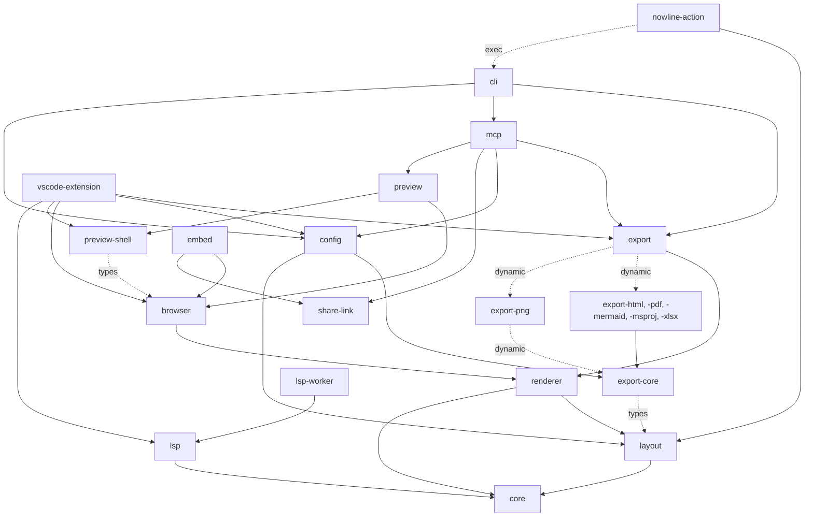

Full review of `main` at a5287055ac8da4a7312d2e780f3aff5ff648547d (613 commits, v0.12.0 plus #241), the first logged review. It discharges the review gate after m4.15. Seven fresh reviewers covered architecture, contracts, security, tests, dependencies and duplication, and two hotspot slices; a verifier tried to disprove each finding. Register: [`2026-11-04-r1-full-findings.md`](2026-11-04-r1-full-findings.md).

## Review guide

Review tier: [skim], records only; the decisions below are the reading.
Verdict: 9 high, 22 medium, 2 low; 6 decisions for you; 0 of 33 dropped by the verifier, 5 re-rated down.
Review time: ~10 min

The engine is in good shape: the m4.11 to m4.14 refactors held (one scheduler, one AST walk, one staging function, ordered finalize), and no package imports against the documented direction. The debt has moved to the edges. The MCP server's sandbox is weak in three ways, and each surface's host glue (asset guard, option resolution, MCP hosting) is hand-copied and has drifted.

## Decisions for you

1. **r1.f21 VS Code Export and `.nowlinerc` export keys.** Now: Export reads only `nowline.export.*`; `ide.md` says it also reads the rc's pdf, font and `defaultFormat` keys. Options: implement it through `@nowline/config` (recommended), or narrow `ide.md`.
2. **r1.f22 Font precedence.** Now: `NOWLINE_FONT_*` overrides MCP's headless bundled fonts, and an rc font beats the env, against the m2c handoff; none of it is in `cli.md` or the man page. Recommended: `headless` wins for MCP, keep env above rc, and document it.
3. **r1.f23 Browser-safe export kernel.** Now: html, mermaid, msproj and xlsx pull `node:*` in through export-core's main entry, and the browser gate tests only json, svg and png. Options: make those four browser-safe (recommended), or document browser support as json, svg and png only.
4. **r1.f12 `-f nowline` over its own input.** Now: `nowline x.nowline -f nowline` rewrites `x.nowline` and drops its comments. Recommended: exit 2 when the default output is the input, for every format.
5. **r1.f13 `scale` `label:` and `name:`.** Now: they're specified and in four examples, but they do nothing. Recommended: remove them and warn, unless a consumer needs sprint labels.
6. **r1.f14 `after:` terms the chart drops.** Now: Mermaid and MS Project link `after:` references the chart and XLSX ignore, so dates differ. Recommended: exporters write only the terms the scheduler resolved, and WV12 warns outside waves too.

## Fix now

- r1.f1 high: MCP `read`/`delete` reach any file in the root; symlinks and includes reach outside it
- r1.f2 high: MCP `--port` has no Host or Origin check, so a web page can drive it (with f1: read and delete files)
- r1.f3 high: HTML export puts the title into `aria-label` with text escaping (attribute injection)
- r1.f4 high: any commenter can move the agent label state machine with the maintainer PAT
- r1.f7 high: every transient parse stays in Langium's index; the preview and MCP leak up to ~660 KB per render
- r1.f8 high: the export scheduler ignores `after:<dated milestone>`; XLSX and Mermaid wave ends disagree with the chart
- r1.f9 high: Mermaid ids for repeated titles collide, so `after` chains resolve to the wrong task
- r1.f15 high: `nowline --mcp --root` returns binaries inline and reports version 0.6.0
- r1.f16 high: VS Code Save and Export don't use the preview's theme, locale, timezone or buffer
- medium: r1.f5 `link:` schemes, r1.f6 release supply chain, r1.f10 MCP review raster, r1.f11 Mermaid keywords, r1.f17 PNG scale default, r1.f18 Copy SVG, r1.f19 Action markdown mode, r1.f20 CLI docs, r1.f24 and r1.f25 `architecture.md`, r1.f26 asset guard copies, r1.f27 to r1.f30 test gates, r1.f31 zod advisory

## Architecture

The package graph as the code has it at a528705 (solid: runtime imports; dotted: type-only, dynamic or exec). `architecture.md`'s graph omits config, share-link and preview and misdescribes mcp, cli, embed, preview-shell and the Action (r1.f25). No cycles, no upward imports.

The Node host layer is the weak seam: the CLI, `--serve`, MCP and the VS Code extension each build their own `HostEnv`, asset guard and option resolution, and only the CLI wires the include policy (r1.f1, r1.f15, r1.f16, r1.f21, r1.f26).

## Rules changed

Proposed, not written; your call:

- `AGENTS.md`: "Node host code (the `HostEnv`, asset and include guards, option resolution, MCP hosting) lives once in a shared package; surfaces call it, they don't copy it." Five findings this review: r1.f1, r1.f15, r1.f16, r1.f21, r1.f26.
- `AGENTS.md`: "A string from a `.nowline` file reaches another format only through that format's escaper, with a test that uses a hostile title." Three this review: r1.f3, r1.f5, r1.f11.
- `AGENTS.md`: "A regression gate fails in CI when its baseline or subject is missing; it never writes or skips." Three this review: r1.f27, r1.f29, r1.f30.
- A `make lint` check that declared dependencies match imports (r1.f25, r1.f33).

Fix review

None: no earlier logged review. Of the unlogged v0.8.6 review's items, the reviewers found these fixed at a528705: the msproj `<StartDate>` fallback, the `DATE_RE`/`stripColon`/`propKey` copies, the calendar classifiers, the content walks, the three scheduler engines, `--serve`'s own pipeline, MCP's option normalization, the logo pre-layout copies and the LSP icon list.

Details by dimension

**Low** (in the register): r1.f32 CI's gate cell floats Node 26 and 22 while release uses the pin, the published engines floor sits below a dependency's, and three files give three pnpm versions; r1.f33 `@nowline/cli` and four other packages declare dependencies they never import.

**Below the floor, not registered:** exceljs has had no release since 2023-10 and brings deprecated packages into the binary, `.vsix` and `.mcpb` (worth a decision later); test files are never type-checked; `runCliBuilt` maps a signal-killed child to exit 0; `calendar:full` with a `length:` that isn't a multiple of 7 leaves no closing tick; the days-scale `M/D` label ignores the locale; swimlane `after:` is accepted and ignored; MCP root checks miss Windows drive-letter case; a few dead exports and small duplicates (preview-shell theme list, MCP `capabilities` lists, the Action's non-working parser).

**Covered.** Architecture: a declared-versus-imported matrix for every package, an import-cycle scan, Node built-ins in browser-safe packages, every surface traced onto the kernel, `stageRoadmap` and `@nowline/config`. Contracts: CLI, MCP, VS Code settings, Action inputs, embed, share-link, `exports` maps, NL codes against `dsl.md` and `nowline.5`. Security: renderer escaping and the SVG sanitizer, exporters, embed, include resolver, CLI asset resolver and `--serve`, webview CSP, the Action's exec, every workflow and the OSS boundary (holds). Tests: every package's `src` against its `test`, CI and Makefile wiring, snapshot and determinism suites, 90 days of test history. Dependencies: every manifest, the lockfile against npm's advisory API and registry. Hotspots: every line of `mcp/src/server.ts`, `preview-shell/src/mount.ts`, `include-resolver.ts`, `cli/src/commands/render.ts`, `vscode-extension/src/extension.ts`, `layout/src/phases/finalize.ts`, `view-preset.ts`, `export-msproj` and `export-mermaid`; man pages and `hashes.json` skipped as data. Not covered: LSP internals, the French man pages, the generated gh-aw lock files beyond their role gate, a live Mermaid render (r1.f9 and r1.f11 come from Mermaid's grammar source).

